# Portafolio de Evidencias
**Asignatura:** Sistemas Programables  
**Docente:** ISC. Gabriel Ubaldo González Cauich  
**Estudiante:** Ricardo Jesus Pech Pool  
**Fecha:** 24/09/2026  
**Parcial / Unidad:** Parcial 1  

---

## 📌 Unidad 1: Sensores
### Competencias
#### Específica(s):
- Aplica principios físicos y comprende
transductores y sensores   
- Analiza y sintetiza la función de los sensores
diversos y sus aplicaciones.
- Aplica sensores de luz, temperatura y su
relación con la variable mensurable
- Organiza y clasifica información proveniente
de fuentes diversas.   
#### Genéricas:
- Habilidades para buscar, procesar y analizar
información procedente de fuentes diversas  
- Capacidad de comunicación oral y escrita  
- Capacidad de trabajo en equipo
- Habilidad para trabajar en forma autónoma.
---

### 📝 Evaluación Diagnóstica

**Descripción:**  
Evaluación inicial del curso para determinar el nivel de conocimientos previos en conceptos básicos de programación, circuitos y sistemas embebidos antes de abordar la materia.

- **Actividad:** Resolución del formulario en línea y transcripción/corrección de los reactivos en libreta como evidencia.
- **Estatus de entrega:** Entregado en Google Classroom.
- **Evidencia:**

| Formulario / Entrega |
| :---: |
| 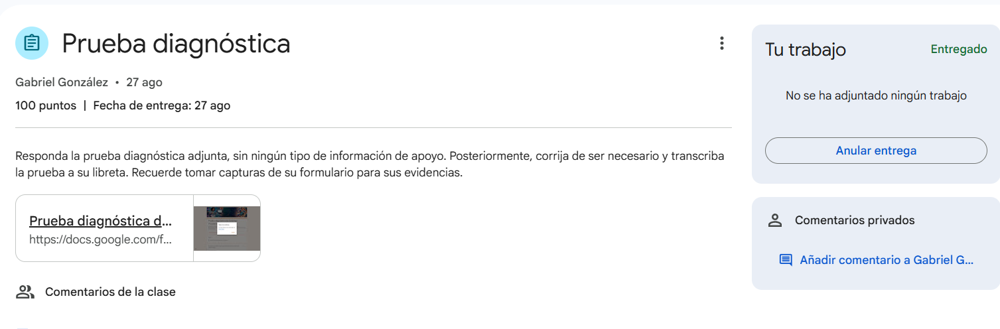 |

---
### 📝 Tarea 1: Investigacion tipos de robots
- **Fecha de entrega:** 02/09/2026
- **Descripción:** Investigación teórica sobre las distintas clasificaciones de robots, analizando su configuración, morfología y grados de libertad. La actividad incluyó la elaboración de una tabla comparativa para diferenciar arquitecturas industriales, móviles y de servicio, entregada en formato PDF.
#### 📸 Evidencias / Capturas
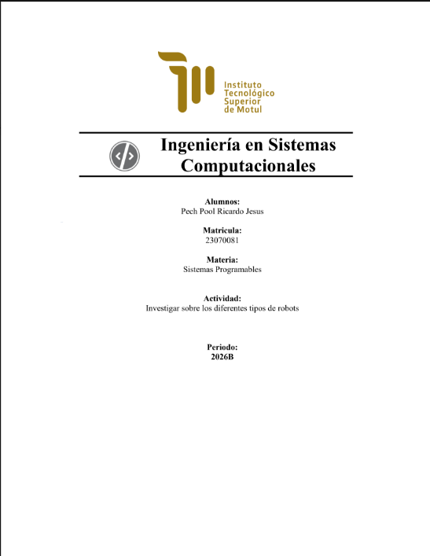
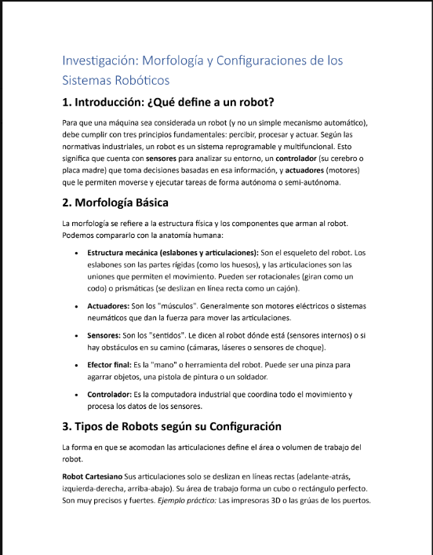
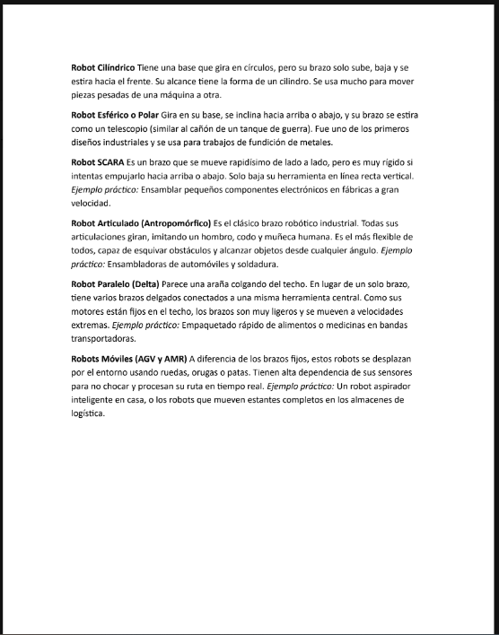
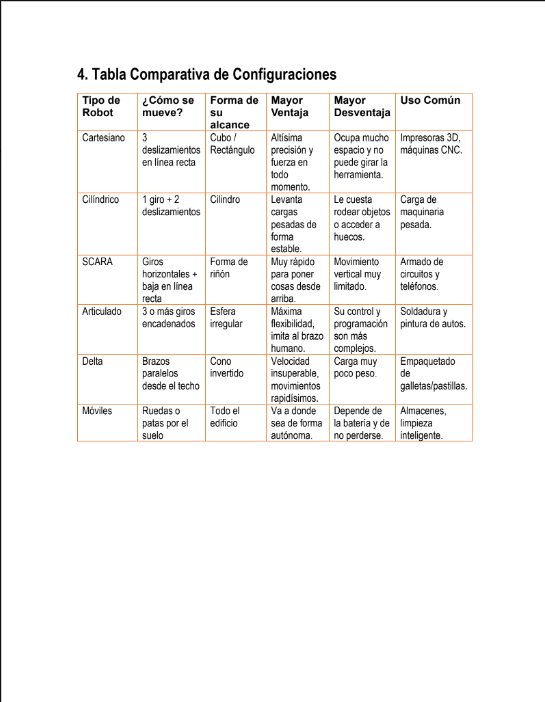
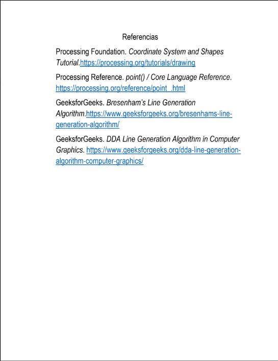
#### 💡 Reflexión sobre aprendizajes obtenidos
> **¿Qué aprendizajes obtuve de la actividad?**
> *En esta investigación aprendí a clasificar los diferentes tipos de robots según su morfología, estructura mecánica y grados de libertad. Identifiqué las diferencias clave entre las distintas configuraciones cinemáticas (cartesianas, SCARA, articuladas) y comprendí cómo seleccionar la arquitectura adecuada en función de la tarea que se desea automatizar.*

#### 🛠️ Análisis de errores y propuesta de mejora
> **¿Qué errores cometí y cómo puedo mejorar aún más la actividad?**  
> *Al principio tuve confusión para diferenciar algunas configuraciones mecánicas similares, como los robots SCARA y los poliarticulados. Lo solucioné analizando a detalle el tipo de articulaciones (prismáticas o rotacionales) que compone a cada uno. Para futuras investigaciones, me gustaría incorporar esquemas visuales o diagramas del área de trabajo (workspace) de cada robot para complementar mejor la información teórica..*

---
### 📝 Tarea 2: Laboratorio de robótica 1
- **Fecha de entrega:** 07/09/2026
- **Descripción:** En esta práctica realizada en la plataforma GearsBot, se desarrolló un programa en Python para controlar un robot simulado. Se programaron desplazamientos por tiempo para avanzar y retroceder, trayectorias en arco, giros sobre su propio eje en sentido horario o antihorario, además de incluir comentarios en las funciones e imprimir los estados del robot en consola personalizados con mi nombre y emojis.
#### 📸 Evidencias / Capturas
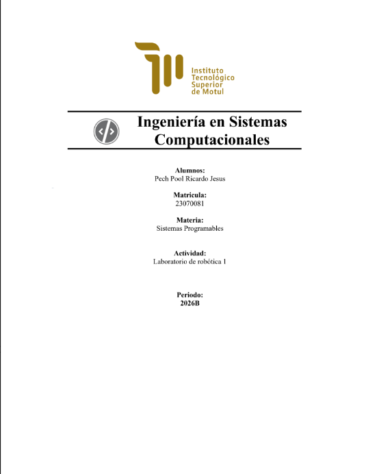
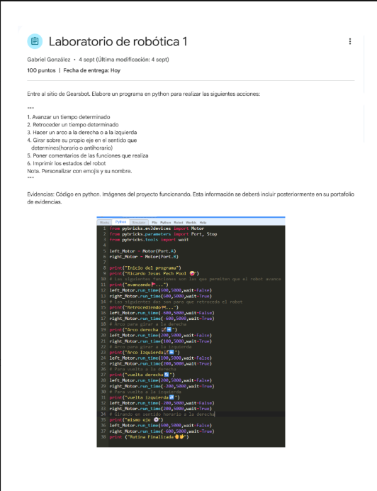
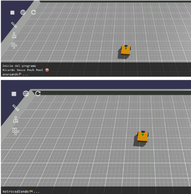
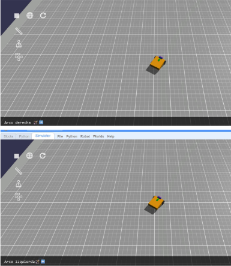
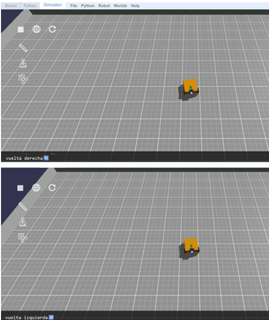
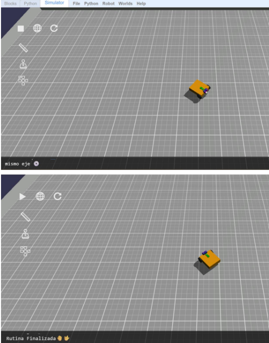

#### Video 📹
https://drive.google.com/file/d/1XGuu6Xme0vdwGMeqlF9ISBNdUpE7xWue/view?usp=sharing

#### 💡 Reflexión sobre aprendizajes obtenidos
> **¿Qué aprendizajes obtuve de la actividad?**  
> *En esta práctica aprendí a utilizar la plataforma GearsBot para simular entornos de robótica programando en Python. Comprendí cómo manipular los motores para hacer giros precisos, trayectorias en arco y control por tiempo, además de la importancia de imprimir los estados en pantalla para saber qué acción está realizando el robot en cada momento.*

#### 🛠️ Análisis de errores y propuesta de mejora
> **¿Qué errores cometí y cómo puedo mejorar aún más la actividad?**  
> *Al inicio tuve problemas para lograr que el giro en arco saliera fluido porque la diferencia de velocidad entre los dos motores era muy alta y el robot terminaba girando sobre su propio eje. Lo solucioné ajustando los valores de potencia hasta conseguir la curva deseada. Para la próxima práctica me gustaría probar el uso de sensores de giro para hacer las vueltas de forma más exacta sin depender únicamente del tiempo.*

---
### 📝 Tarea 3: Laboratorio de robótica 2
- **Fecha de entrega:** 14/09/2026
- **Descripción:** En esta práctica de laboratorio se desarrollaron funciones en Python para controlar el movimiento de un robot (avanzar, retroceder, girar a la derecha, girar a la izquierda y detenerse). Además, se integró el sensor de ultrasonido para medir distancias y esquivar objetos, configurando el mapa con obstáculos mediante un archivo JSON y mostrando en consola los estados del robot en tiempo real.
#### 📸 Evidencias / Capturas
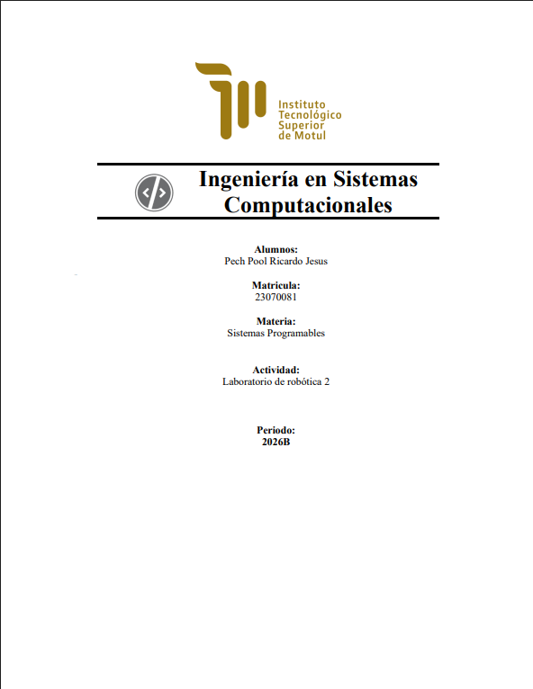
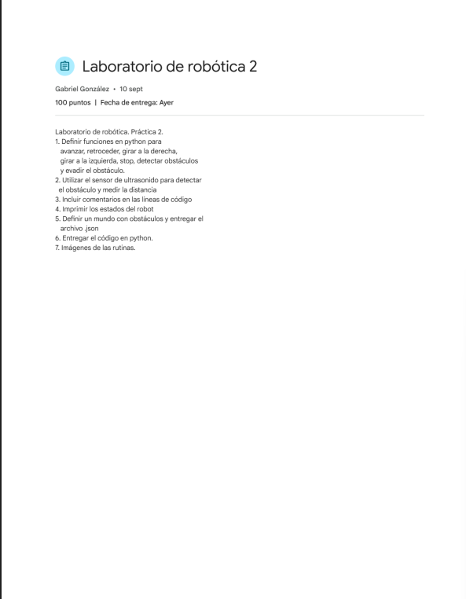
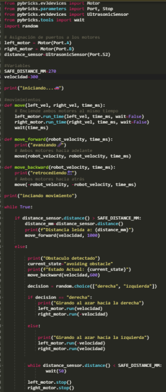
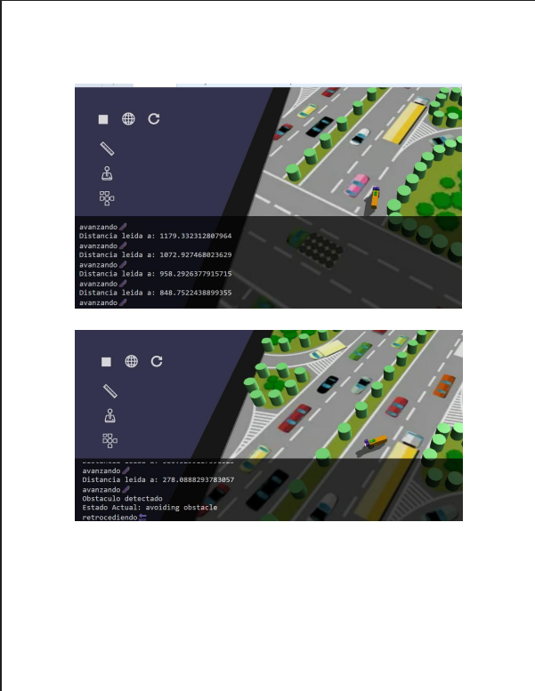
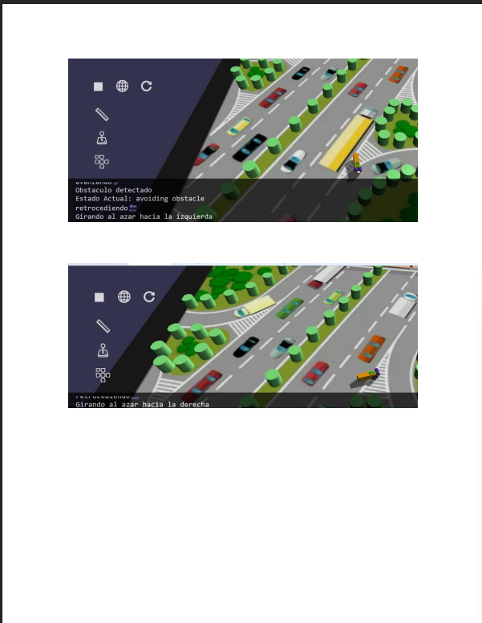
#### Video 📹
https://drive.google.com/file/d/1lRHVad-dcn17Orh667c-G6Zr_ECY9yUL/view?usp=sharing

#### 💡 Reflexión sobre aprendizajes obtenidos
> **¿Qué aprendizajes obtuve de la actividad?**  
> *En esta práctica aprendí a estructurar mi programa mediante funciones independientes para controlar cada movimiento del robot. También entendí cómo funciona la lógica para procesar los datos de un sensor de ultrasonido, lo que me permitió tomar decisiones automatizadas dentro del código para evadir objetos sin la intervención de una persona.*

#### 🛠️ Análisis de errores y propuesta de mejora
> **¿Qué errores cometí y cómo puedo mejorar aún más la actividad?**  
> *Al principio el robot chocaba antes de girar porque la distancia que le asigné al sensor para detenerse era muy corta y no le daba tiempo de hacer la maniobra. Lo solucioné aumentando el margen de distancia en la condición del sensor para que detectara los obstáculos con más anticipación. Para las siguientes prácticas puedo mejorar el programa creando trayectorias de evasión más fluidas en lugar de detenciones repentinas.*

---
### 📝 Practica 1: Práctica de laboratorio 1. Control de actuadores con el ESP32
- **Fecha de entrega:** 14/09/2026
- **Descripción:** En esta práctica de laboratorio se implementó una aplicación embebida utilizando el microcontrolador ESP32 para controlar 3 LEDs (actuadores) mediante la lectura de un botón pulsador. Se programaron las entradas y salidas digitales para manipular la secuencia o el estado de los LEDs según la pulsación recibida.

#### 📸 Evidencias / Capturas
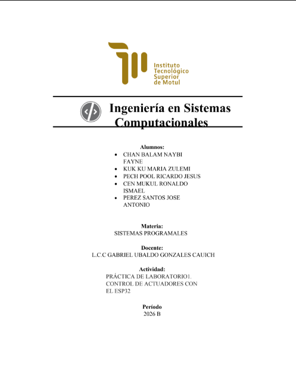
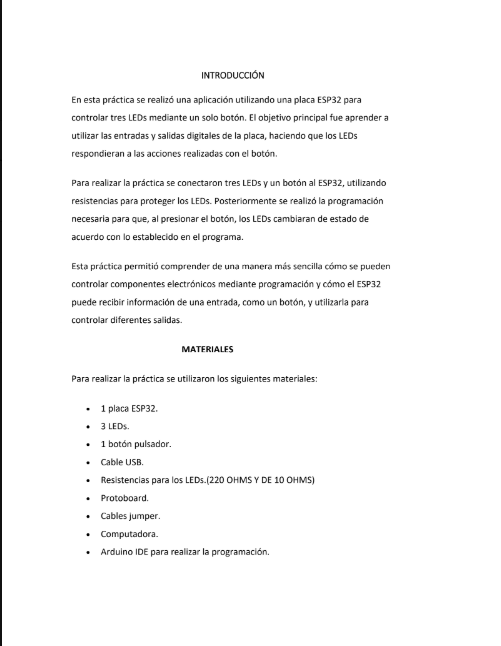
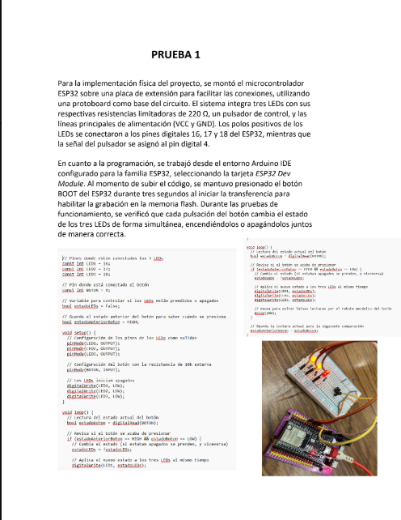
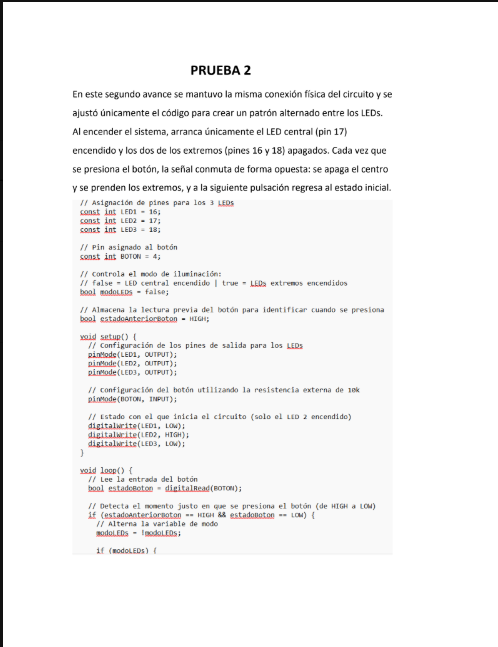
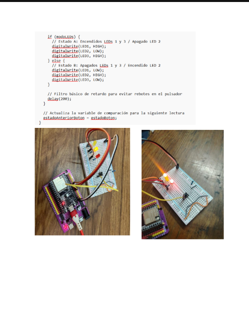
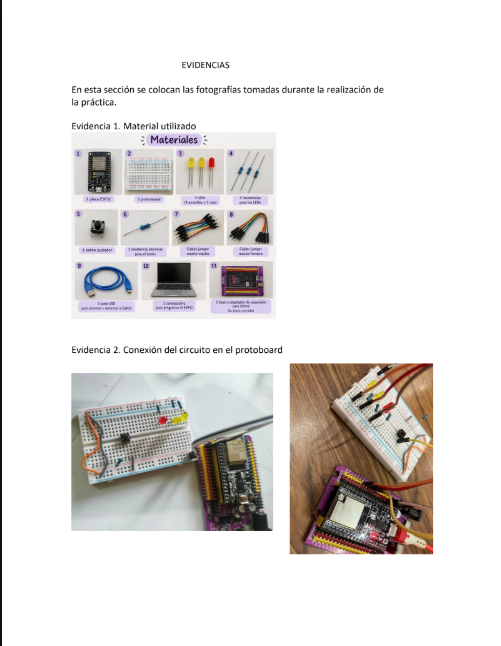
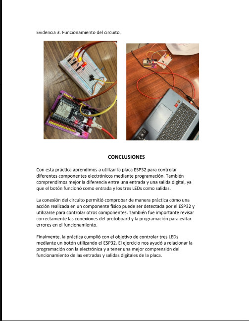
#### 💡 Reflexión sobre aprendizajes obtenidos
> **¿Qué aprendizajes obtuve de la actividad?**  
> *En esta práctica aprendí a configurar los pines de la ESP32 para controlar entradas y salidas digitales. Entendí cómo conectar y programar un botón para que al presionarlo cambie el estado o la secuencia de los tres LEDs, lo cual me ayudó a ver de forma práctica cómo un microcontrolador procesa una orden física y responde encendiendo componentes.*

#### 🛠️ Análisis de errores y propuesta de mejora 
> **¿Qué errores cometí y cómo puedo mejorar aún más la actividad?**  
> *Al principio la práctica no funcionaba bien porque la resistencia conectada al botón se había movido de su lugar en el protoboard y hacía falso contacto. Esto provocaba que la lectura del botón fuera inestable y los LEDs no respondieran correctamente. Lo solucioné revisando el circuito físico, reacomodando la resistencia y asegurándome de que todas las conexiones estuvieran firmes. Para las siguientes actividades voy a revisar mejor el armado antes de cargar el código.*

---
## 🎯 Conclusión y Reflexión Final de la Unidad 1

Durante esta primera unidad logré integrar los fundamentos teóricos de la programación y el control de sistemas con la práctica directa en simuladores y microcontroladores. El desarrollo de las actividades me permitió avanzar gradualmente, empezando por el control de actuadores y entradas digitales en el ESP32, hasta la implementación de algoritmos de navegación y procesamiento de datos de sensores para la evasión de obstáculos en robótica.

Esta experiencia me ayudó a fortalecer mi capacidad de análisis y resolución de problemas, ya que aprendí a identificar fallas tanto en el código como en la calibración de componentes físicos y virtuales. En las siguientes unidades me propongo continuar optimizando la estructura de mis programas y explorar técnicas de control más avanzadas para desarrollar proyectos más eficientes.

---
## 📌 Unidad 2: Sensores, Actuadores y Microcontroladores
### Competencias
#### Específica(s):
- Aplica principios físicos y comprende
transductores y sensores
- Analiza y sintetiza la función de los sensores
diversos y sus aplicaciones.
- Aplica sensores de luz, temperatura y su
relación con la variable mensurable
- Organiza y clasifica información proveniente
de fuentes diversas. 

- Aplica principios teóricos de
electromagnetismo para analizar actuadores.
- Identifica y diferencia los actuadores
eléctricos, mecánicos e hidráulicos.
- Explica con propiedad la función de los
actuadores y el papel de estos en la industria.
- Ensambla los circuitos respectivos empleando
sensores y actuadores.

- Identifica las características eléctricas de un
microcontrolador.
- Conoce la arquitectura interna del
microcontrolador.
- Comprende la estructura de registros del
microcontrolador.
- Analiza dispositivos de entrada/salida y
puertos del microcontrolador.
#### Genéricas:
- Habilidades para buscar, procesar y analizar
información procedente de fuentes diversas
- Capacidad de comunicación oral y escrita
- Capacidad de trabajo en equipo
- Habilidad para trabajar en forma autónoma.

- Capacidad de aplicar los conocimientos en la
práctica.
- Capacidad de abstracción, análisis y síntesis.
- Capacidad para identificar, plantear y resolver
problemas.
- Capacidad de comunicación oral y escrita.

- Capacidad de aplicar los conocimientos en la
práctica
- Capacidad de abstracción, análisis y síntesis
- Capacidad para tomar decisiones
---
### 📝 Tarea 1 U2: Adquisición de kit robótico
- **Fecha de entrega:** 30/09/2026
- **Descripción:** La tarea "Adquisición de kit robótico" consiste en evaluar en equipo diferentes opciones de kits para comprar uno que permita construir un robot móvil de tracción diferencial. El kit seleccionado debe cumplir con medidas de 30 cm x 25 cm, ser compatible con un microcontrolador ESP32 para su control e incluir un módulo de giroscopio con acelerómetro, tomando como referencia técnica la convocatoria adjunta en PDF.
#### 📸 Evidencias / Capturas
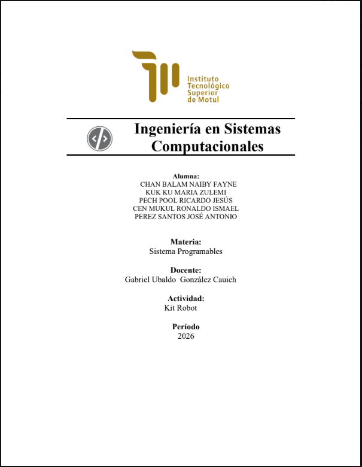
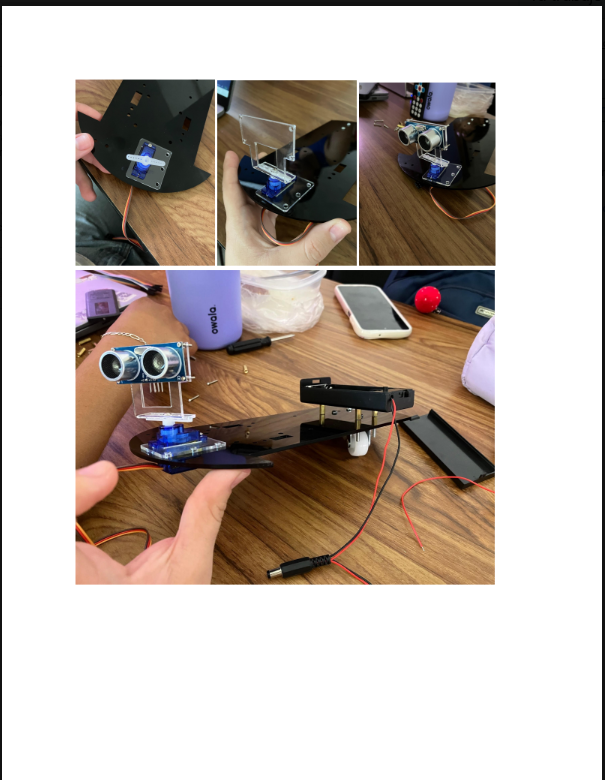
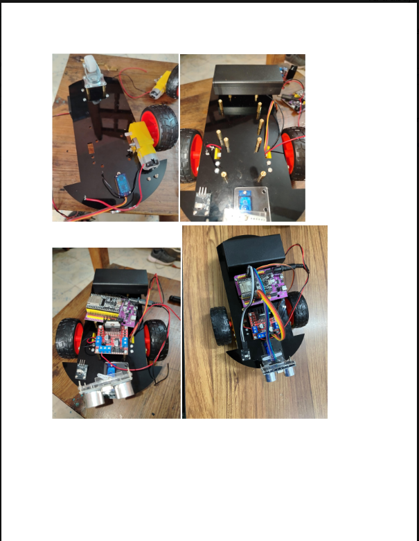
#### 💡 Reflexión sobre aprendizajes obtenidos
> **¿Qué aprendizajes obtuve de la actividad?**  
> *En esta actividad aprendí a evaluar y seleccionar componentes electrónicos y mecánicos bajo requerimientos específicos, considerando la tracción diferencial, las dimensiones del chasis (30 cm x 25 cm) y la integración del microcontrolador ESP32 junto con un módulo de giroscopio y acelerómetro para el control y navegación del robot móvil. Además, fortalecí mi capacidad para interpretar documentos técnicos y normativas de convocatoria para alinear el diseño a las especificaciones requeridas.*

#### 🛠️ Análisis de errores y propuesta de mejora
> **¿Qué errores cometí y cómo puedo mejorar aún más la actividad?**  
> *El principal error cometido fue adquirir inicialmente un kit robótico demasiado pequeño que no contaba con el espacio físico ni la capacidad estructural adecuada para montar holgadamente el ESP32, el giroscopio con acelerómetro y el resto de los componentes. Para mejorar aún más la actividad, es fundamental analizar minuciosamente las dimensiones (respetando el límite de 30 cm x 25 cm) y la distribución del chasis antes de realizar la compra, asegurando que la estructura soporte todo el hardware requerido sin comprometer el sistema de tracción diferencial.*

---
### 📝 Tarea 2 U2: Evaluación 1.  Control y maniobra
- **Fecha de entrega:** 16/10/2026
- **Descripción:** La tarea "Evaluación 1. Control y maniobra" consiste en controlar el vehículo para que recorra un circuito evadiendo al menos 4 obstáculos, además de subir una rampa, girar y bajar para regresar en ambas pruebas al punto de origen. Los resultados y evidencias de estas maniobras se deben entregar en formato de reporte, siguiendo la rúbrica adjunta y las reglas publicadas en el tablón de anuncios.
#### 📸 Evidencias / Capturas
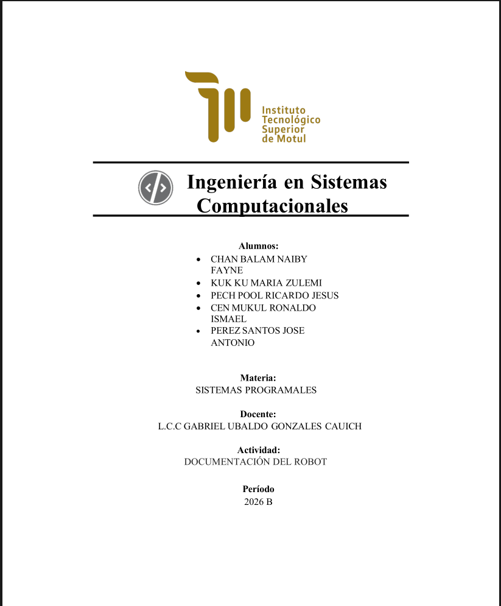
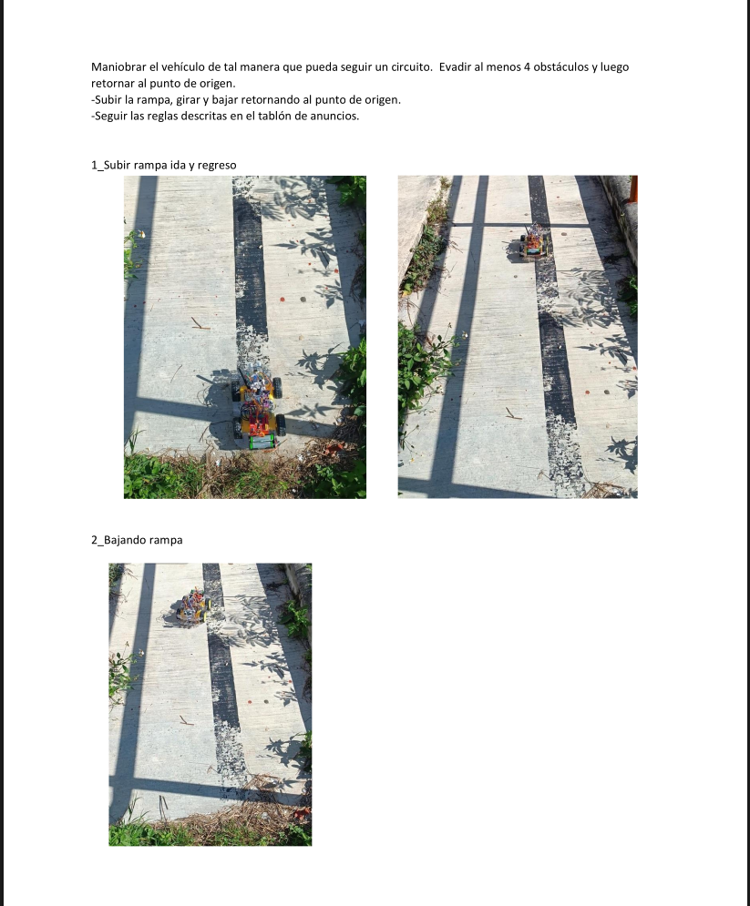
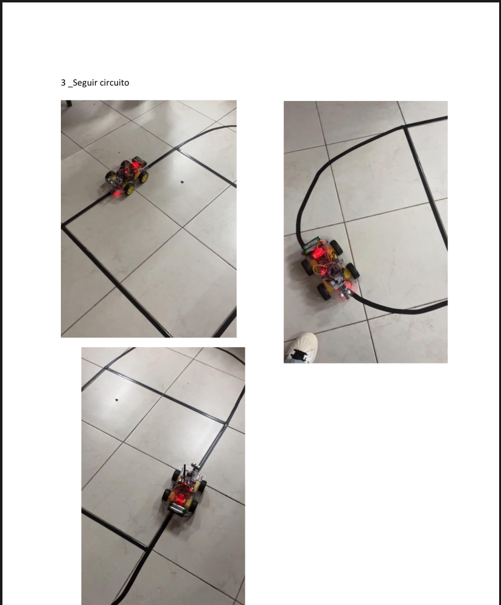
#### 💡 Reflexión sobre aprendizajes obtenidos
> **¿Qué aprendizajes obtuve de la actividad?**  
> *En esta actividad aprendí a implementar algoritmos de control de navegación para que el vehículo siga un circuito determinado y esquive al menos 4 obstáculos con precisión. Asimismo, adquirí experiencia en la gestión de tracción y torque del robot para afrontar pendientes al subir y bajar la rampa con estabilidad, controlando el retorno seguro al punto de origen y documentando adecuadamente las pruebas en un reporte técnico.*

#### 🛠️ Análisis de errores y propuesta de mejora
> **¿Qué errores cometí y cómo puedo mejorar aún más la actividad?**  
> *Durante las pruebas de control y maniobra, los principales errores cometidos fueron una calibración deficiente en la velocidad de giro al subir la rampa —lo que ocasionó descompensación en la estabilidad del robot— y un ajuste impreciso en los sensores de proximidad, provocando lecturas erróneas al evadir los 4 obstáculos del circuito. Para mejorar aún más la actividad, es recomendable implementar un control PID para mantener la trayectoria constante en pendientes y ajustar la sensibilidad de detección mediante filtrado de señales en el código antes de realizar los recorridos finales.*

---
### 📝 Tarea 3 U2: Cuadro Comparativo: MCU, MPU
- **Fecha de entrega:** 21/10/2026
- **Descripción:** La tarea "Cuadro comparativo: MCU, MPU" consiste en elaborar de manera individual un cuadro comparativo escrito a mano (entregado en PDF o imagen) sobre los microprocesadores (MPU) y microcontroladores (MCU), incluyendo ejemplos de cada uno. Además, requiere plasmar en la libreta una reflexión que responda a preguntas clave sobre tarjetas de desarrollo (concepto, popularidad, 3 placas conocidas y sus diferencias, uso combinado de MPU/MCU) y la opinión sobre un video de referencia.
#### 📸 Evidencias / Capturas
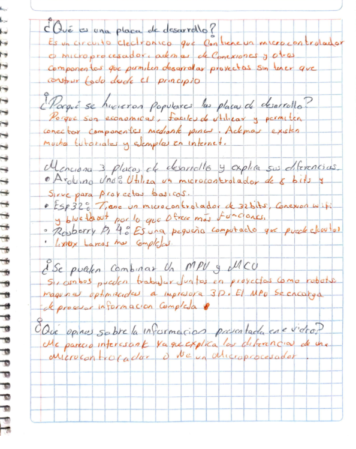
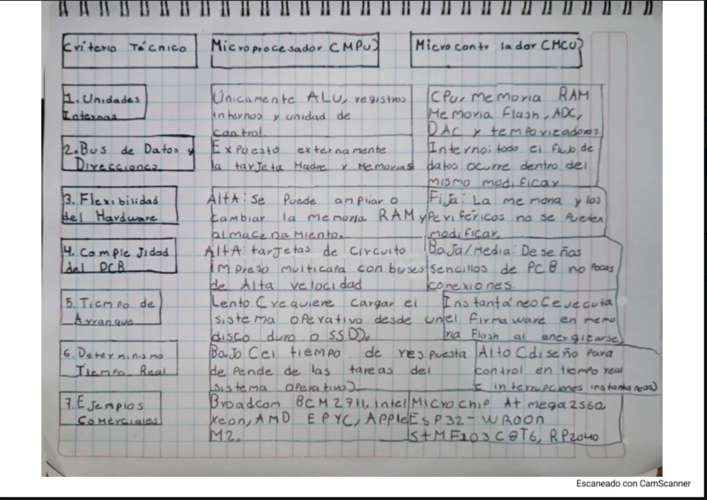
#### 💡 Reflexión sobre aprendizajes obtenidos
> **¿Qué aprendizajes obtuve de la actividad?**  
> *En esta actividad aprendí a diferenciar de forma clara la arquitectura y aplicaciones de los microprocesadores (MPU) frente a los microcontroladores (MCU), identificando cómo cada uno maneja la memoria y el procesamiento de datos. Además, profundicé en el papel clave de las tarjetas de desarrollo más populares en la industria, comprendiendo su impacto en el prototipado rápido y evaluando la factibilidad de integrar arquitecturas híbridas (MCU + MPU) en proyectos embebidos complejos.*

#### 🛠️ Análisis de errores y propuesta de mejora
> **¿Qué errores cometí y cómo puedo mejorar aún más la actividad?**  
> *En esta actividad, el principal error fue no realizar una investigación más profunda sobre las limitaciones de memoria RAM y almacenamiento al comparar los MPU y MCU, así como redactar la reflexión de forma muy general sin profundizar del todo en las ventajas técnicas de las placas de desarrollo populares. Para mejorar aún más, es conveniente incluir tablas detalladas con parámetros cuantitativos (como velocidad de reloj, consumo de energía y costo) y profundizar en ejemplos prácticos donde la integración híbrida de MPU y MCU optimice el rendimiento en sistemas embebidos.*

---
### 📝 Tarea 4 U2: Evaluación 2. Sensores
- **Fecha de entrega:** 30/10/2026
- **Descripción:** La tarea "Evaluación 2. Sensores" consiste en programar e integrar tres tipos de sensores en el robot autónomo: el sensor de ultrasonido para detectar y evitar obstáculos, los sensores infrarrojos para la detección y seguimiento de una línea negra sobre fondo claro, y el giroscopio para medir el ángulo de giro y corregir la trayectoria autónoma. Para aprobar la práctica es necesario cumplir con al menos dos de los tres objetivos planteados, entregando las evidencias mediante un reporte y un video de demostración.
#### 📸 Evidencias / Capturas
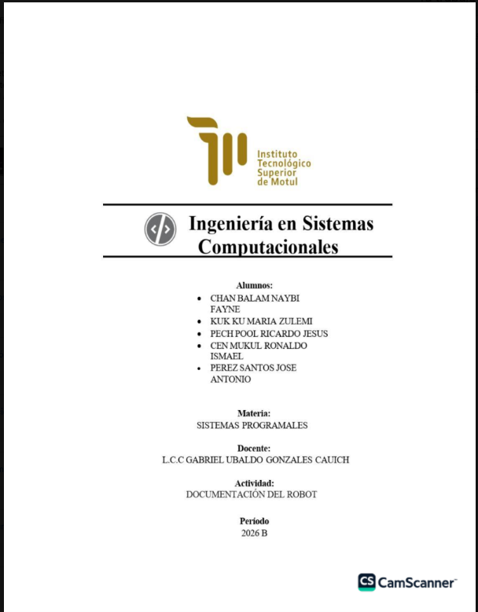
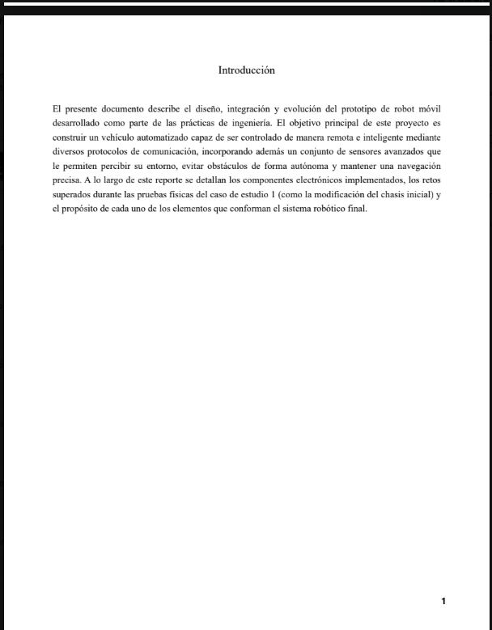
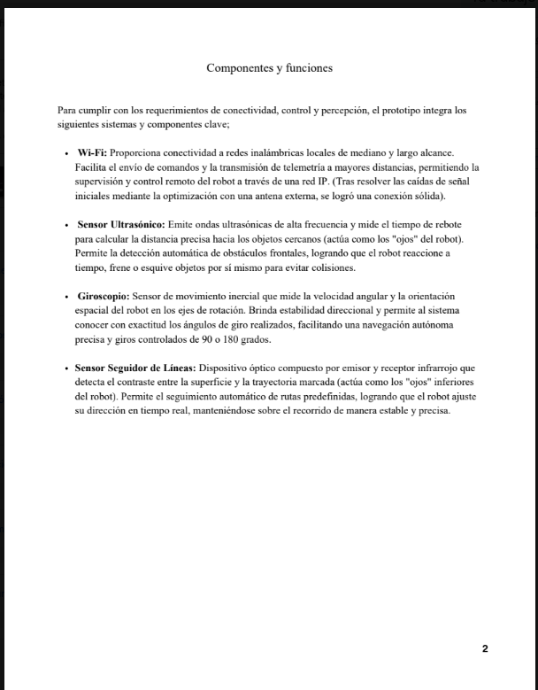
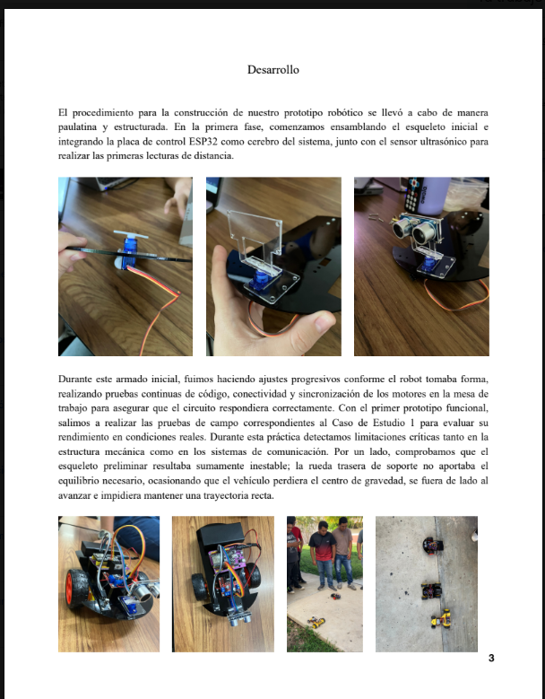
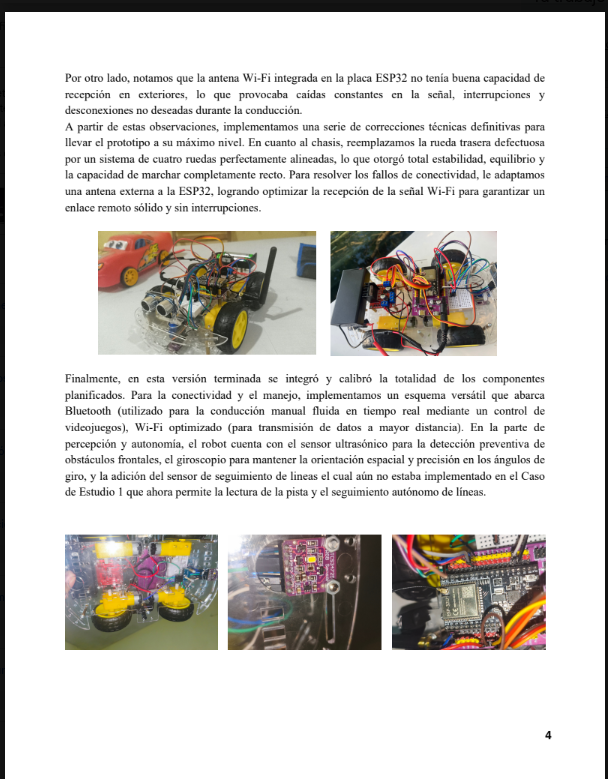
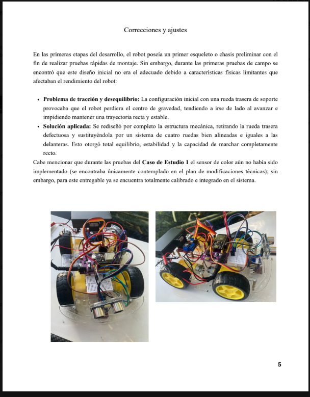
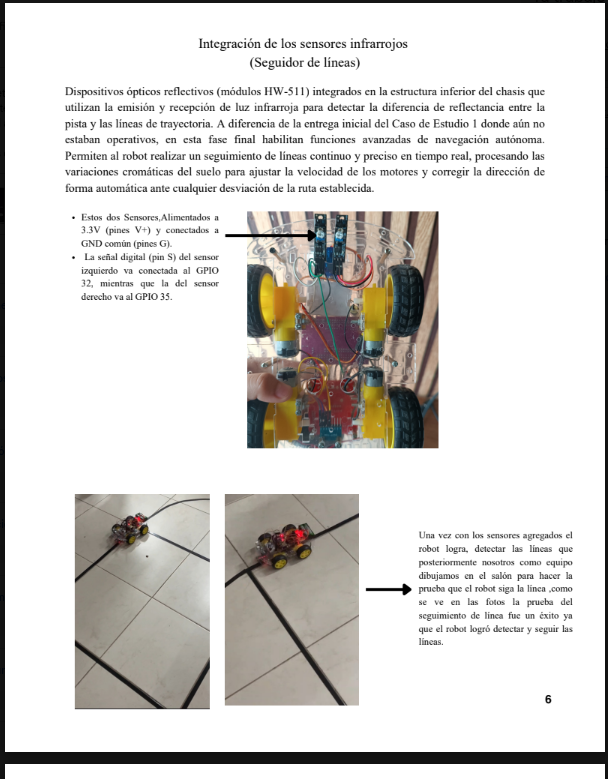
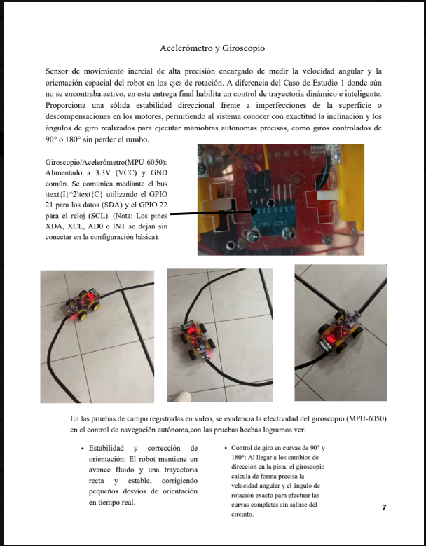
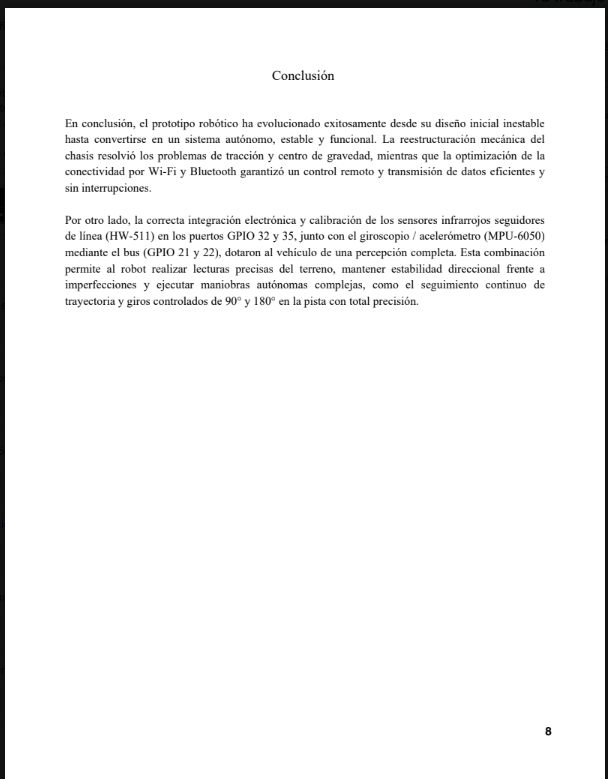

#### Video 📹
https://drive.google.com/file/d/15I4yfDvWp3Soze-oDUChcf41lUghoL0r/view?usp=sharing

#### 💡 Reflexión sobre aprendizajes obtenidos
> **¿Qué aprendizajes obtuve de la actividad?**  
> *En esta actividad aprendí a integrar y acondicionar señales de múltiples sensores en un sistema robótico autónomo, logrando fusionar lecturas del sensor de ultrasonido para evasión de obstáculos, sensores infrarrojos para el seguimiento preciso de línea sobre fondo claro y el giroscopio para realimentar el ángulo de giro y mantener la trayectoria recta. Además, fortalecí mis habilidades en la conexión electrónica adecuada, la modificación del código de programación y la documentación estructurada de proyectos mediante reportes técnicos y evidencias en video.*

#### 🛠️ Análisis de errores y propuesta de mejora
> **¿Qué errores cometí y cómo puedo mejorar aún más la actividad?**  
> *Los principales errores cometidos residieron en una falta de calibración inicial en los umbrales de los sensores infrarrojos frente a variaciones de luz ambiental y en la acumulación de ruido o deriva en las lecturas del giroscopio al corregir la trayectoria del vehículo. Para mejorar aún más la actividad, se sugiere implementar filtros digitales (como un filtro complementario o de Kalman) en la programación para suavizar las lecturas inerciales, realizar pruebas de calibración de contraste antes de iniciar el recorrido e integrar una estructura de control en bucle cerrado (PID) que optimice la respuesta de evasión y seguimiento en tiempo real.*

---
### 📝 Tarea 5 U2: Caso de Estudio 1. Robot Controlado a Distancia
- **Fecha de entrega:** Sin fecha asignada
- **Descripción:** La tarea "Caso de estudio 1. Robot controlado a distancia mediante Wi-Fi" consiste en investigar, diseñar, programar e implementar un robot controlado de manera remota a través de Wi-Fi utilizando la tarjeta ESP32. Para cumplir con el caso de estudio se debe verificar la comunicación remota, determinar el alcance máximo y la velocidad en línea recta del vehículo, evaluar su maniobrabilidad en un circuito con curvas emitiendo un resultado, y competir con otros carros para comprobar su desempeño en equipo.
#### 📸 Evidencias / Capturas
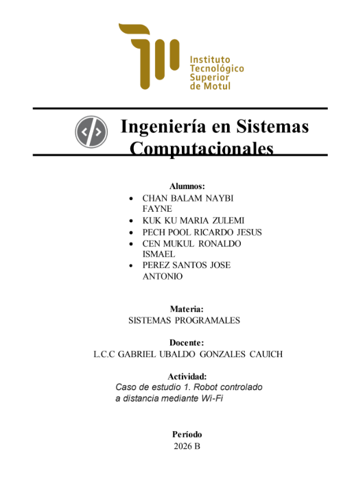
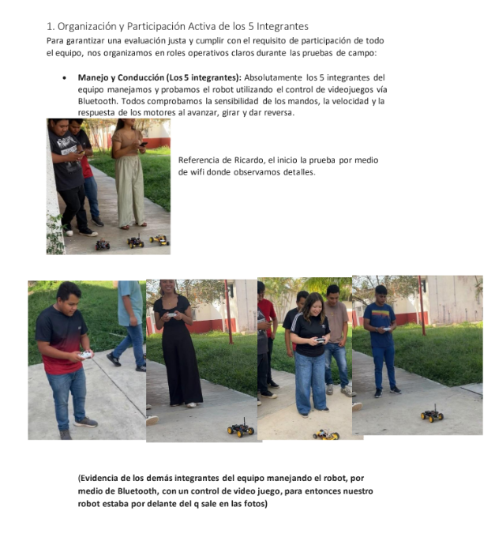
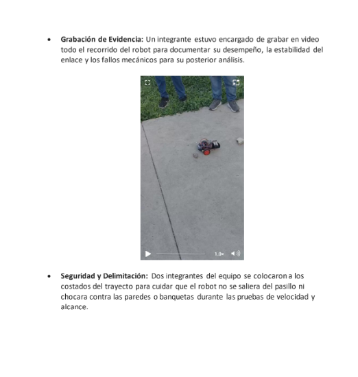
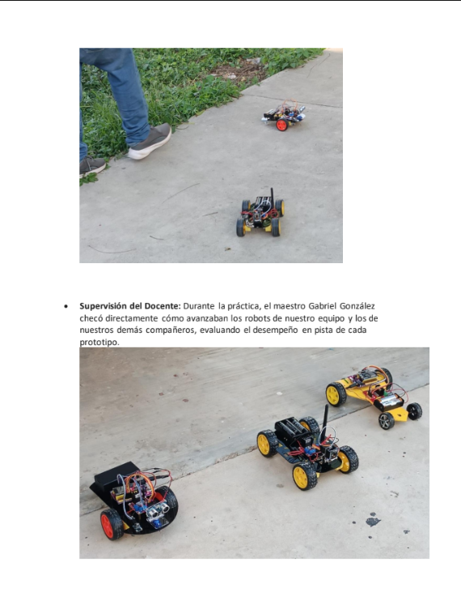
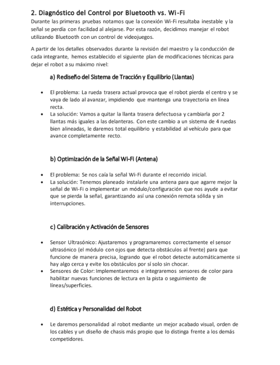
#### 💡 Reflexión sobre aprendizajes obtenidos
> **¿Qué aprendizajes obtuve de la actividad?**  
> *En esta actividad aprendí a configurar y desplegar una red Wi-Fi utilizando la tarjeta ESP32 para establecer una comunicación inalámbrica robusta e interactuar de forma remota con un robot móvil. Asimismo, adquirí conocimientos prácticos al medir cuantitativamente parámetros de rendimiento como la distancia máxima de alcance del enlace inalámbrico y la velocidad lineal en línea recta, además de analizar la maniobrabilidad del vehículo al enfrentar trazados con curvas y competir en dinamismo frente a otros prototipos.*

#### 🛠️ Análisis de errores y propuesta de mejora
> **¿Qué errores cometí y cómo puedo mejorar aún más la actividad?**  
> *Los principales errores cometidos residieron en sufrir latencia excesiva y pérdidas ocasionales de conexión Wi-Fi debido a interferencias en el entorno o saturación del canal, sumado a una respuesta de dirección brusca en el circuito de curvas por falta de un escalado suave en las órdenes de control. Para mejorar aún más la actividad, se recomienda implementar un protocolo de comunicación más ágil (como WebSockets o UDP en lugar de peticiones HTTP convencionales), incorporar un sistema de seguridad tipo failsafe que detenga los motores automáticamente ante desconexiones, y afinar el control de velocidad diferenciado en las ruedas para optimizar el radio de giro en maniobras complejas.*

---

## 🎯 Conclusión y Reflexión Final de la Unidad 2

A lo largo de la segunda unidad de la materia Sistemas Programables, afianzamos los conocimientos teóricos y aplicados respecto a microcontroladores, sensores y actuadores orientados a la robótica móvil. Mediante el desarrollo de las cinco prácticas asignadas, avanzamos paulatinamente desde la fase de análisis y elección de componentes de hardware hasta la construcción e integración de un vehículo robótico autónomo y completamente operativo.

Dentro de las metas más relevantes alcanzadas sobresalen:
- **Dominio de Arquitecturas:** La distinción precisa entre el potencial de cómputo de un MPU y la capacidad de gestión e interacción en tiempo real de un MCU (como el ESP32) al controlar un robot.
- **Acoplamiento de Sensores:** La puesta a punto e interpretación adecuada del sensor MPU-6050 (giroscopio/acelerómetro) usando el canal I2C, el sensor ultrasónico montado sobre un servomotor para la detección y evasión de barreras, y los sensores infrarrojos (HW-511) orientados al rastreo efectivo de líneas en la trayectoria.
- **Superación de Retos Físicos y de Conectividad:** La reestructuración del chasis (sustituyendo la configuración previa de rueda loca por una estructura más firme de 4 ruedas) y la mejora del alcance de red al añadir una antena externa, garantizando una transmisión estable por Wi-Fi y Bluetooth.

Este trabajo realizado en esta unidad nos ofreció la oportunidad de vivir el proceso integral de diseño e implementación de un sistema embebido, evidenciando que tanto el procesamiento continuo de sensores como el equilibro mecánico resultan esenciales para garantizar un recorrido autónomo preciso y una respuesta eficiente durante las pruebas reales.

---

## 📌 Unidad 3:
### Competencias
#### Específica(s):
